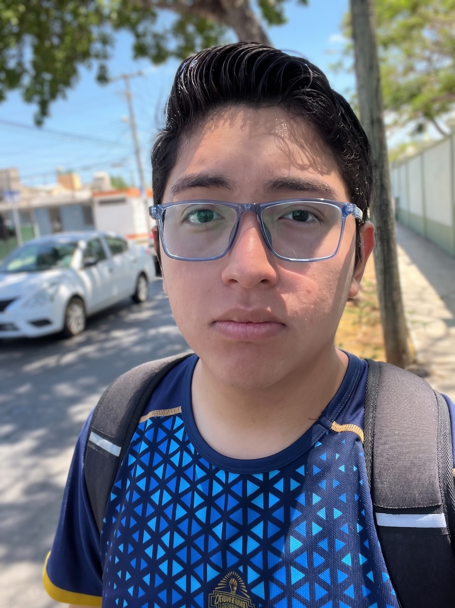
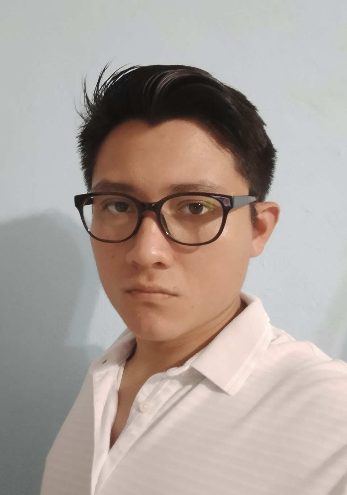

# Proyecto_Arquitecturas_de_Software
Repositorio oficial del equipo para las entregas del proyecto de la asignatura Arquitecturas de Software.

## Miembros del equipo

<table border="1">
  <tr>
    <td align="center"></td>
    <td align="center"></td>
    <td align="center"></td>
    <td align="center"></td>
  </tr>
  <tr>
    <td align="center"><b>Couoh Concha Valeria Fernanda</b></td>
    <td align="center"><b>Gonzalez Alcocer Fabio Leonardo</b></td>
    <td align="center"><b>Gonzalez Chablé Said Alfredo</b></td>
    <td align="center"><b>Pacheco Pacheco Ramón Alonso</b></td>
  </tr>
</table>