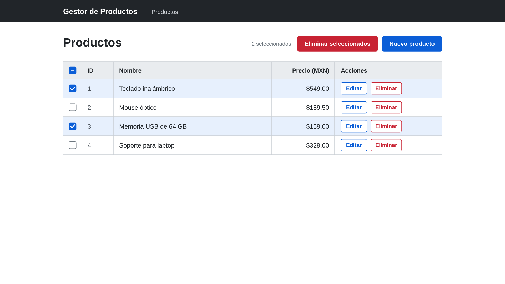
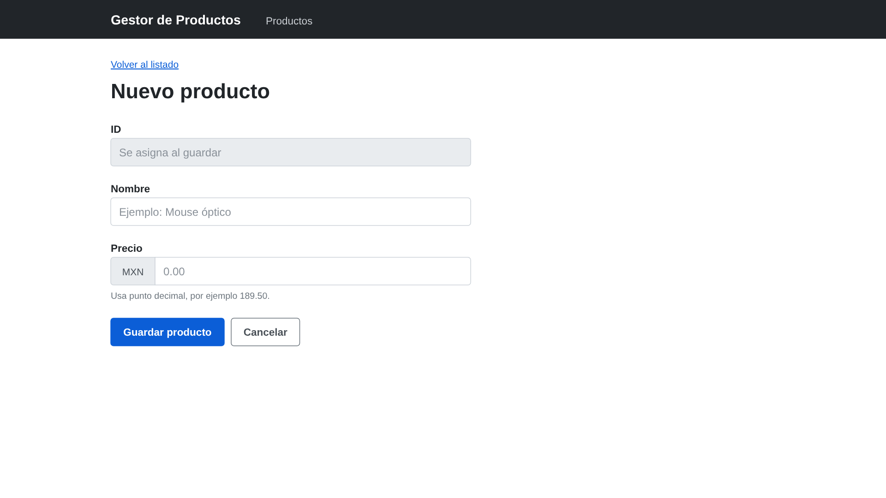
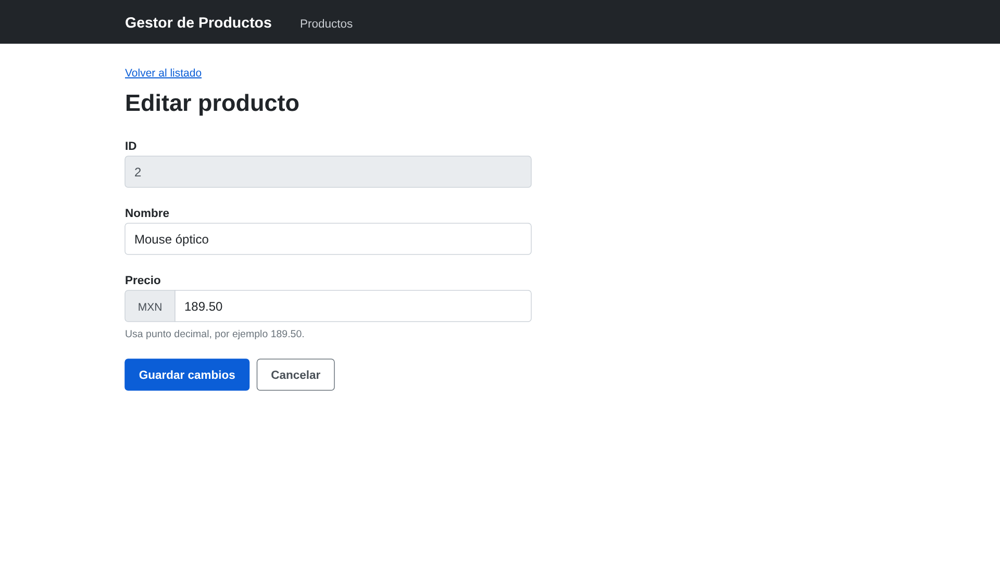
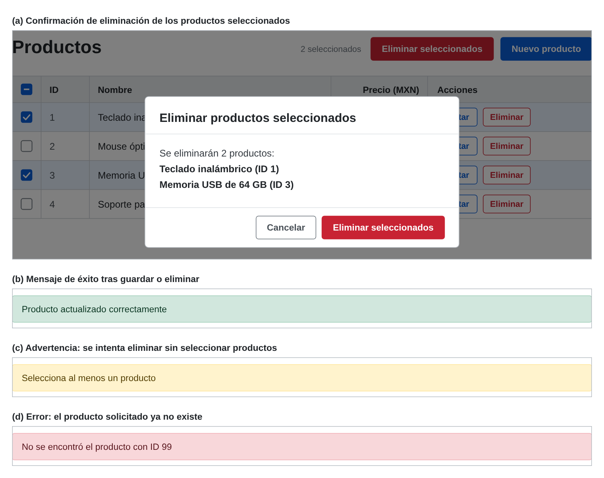
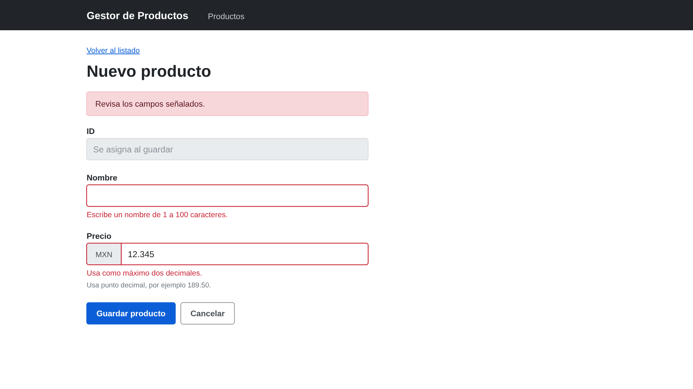
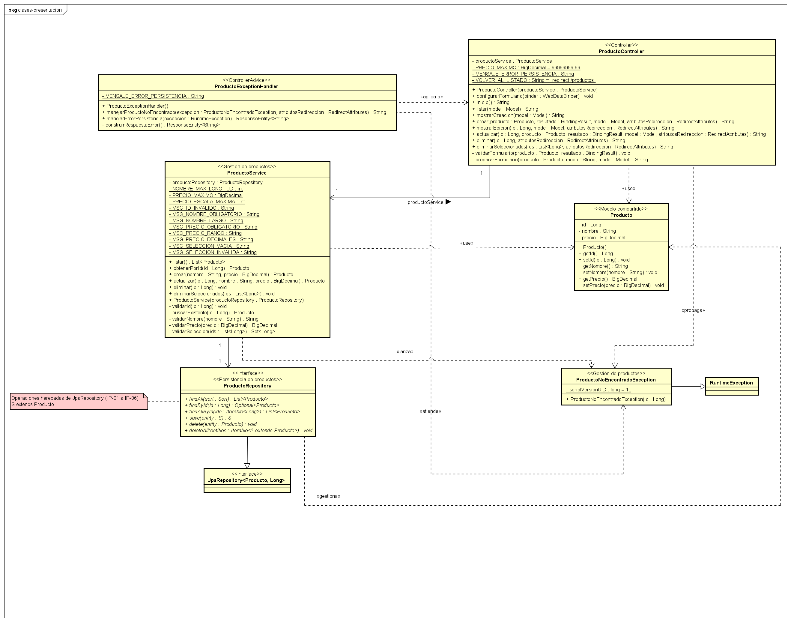

## 2. Diseño de pantallas

La aplicación presentará un catálogo de productos mediante una interfaz web en español. Se utilizarán fondo claro, tipografía legible, bordes discretos y una distribución uniforme. Todas las pantallas comparten una barra superior con el nombre de la aplicación y el enlace Productos. Las acciones de guardado y creación se identificarán en azul; las de eliminación, en rojo y acompañadas de texto. Los mensajes incluirán texto explicativo, de modo que su significado no dependa exclusivamente del color.

El diseño contiene dos plantillas: un listado y un formulario compartido con modos de creación y edición. No se incorporan cuentas, ventas, existencias, búsqueda ni paginación. Los campos del producto son exclusivamente ID, nombre y precio. Los ejemplos de las imágenes no representan registros que deban insertarse en la base.

Las figuras se incluyen en formato PNG. Las maquetas se han preparado en un lienzo de 1280 × 720; sus PNG tienen 1920 × 1080 píxeles, salvo la figura 2.4a, que es una composición de recortes. El tamaño es una referencia visual y no fija una resolución obligatoria para la implementación web.

### 2.1. Listado de productos

**Acceso previsto:** `GET /` redirige a `/productos`; `GET /productos` muestra el listado (IW-01). El controlador solicitará `ProductoService.listar()` y entregará la colección en el atributo `productos` de la vista `productos/listado`.

La tabla mostrará los productos por ID ascendente. Cada fila incluirá una casilla de selección, ID, nombre, precio y las acciones **Editar** y **Eliminar**. Los precios se mostrarán en pesos mexicanos con dos decimales. El listado recibirá una colección vacía cuando no existan registros, nunca `null`.

**Figura 2.1.** Listado con selección parcial: se han marcado los productos con ID 1 y 3 y la casilla superior muestra el estado indeterminado. Las acciones individuales permanecen disponibles.

| Elemento | Comportamiento previsto |
| --- | --- |
| Nuevo producto | Abre `GET /productos/nuevo`. Se mantiene disponible cuando el listado está vacío. |
| Casilla de fila | Marca o desmarca ese producto. Su valor enviado será el ID y su nombre de campo será `ids`. |
| Casilla del encabezado | Marca o desmarca todos los productos del listado. Se mostrará marcada cuando estén todos seleccionados e indeterminada cuando la selección sea parcial. |
| Eliminar seleccionados | Solicita confirmación y, al aceptar, envía los valores repetidos `ids` a `POST /productos/eliminar-seleccionados`. |
| Editar | Abre `GET /productos/{id}/editar` para precargar el formulario. |
| Eliminar | Solicita confirmación y, al aceptar, envía `POST /productos/{id}/eliminar`. |
| Cantidad seleccionada | Se muestra junto a los botones superiores cuando hay filas marcadas, como referencia visual; no añade un campo al producto ni modifica el contrato web. |

**Selección completa.** Al marcar la casilla del encabezado quedan marcadas todas las filas. Eliminar todos utiliza el mismo botón y la misma ruta que eliminar una selección parcial; no existe una operación de borrado total independiente.

**Listado vacío.** Se muestra la tabla sin filas con el mensaje «No hay productos registrados» y permanece disponible **Nuevo producto**. El botón **Eliminar seleccionados** sigue visible: sin productos marcados no envía nada y comunica «Selecciona al menos un producto».

La selección se realiza en el navegador y no envía solicitudes al servicio hasta confirmar la eliminación. El servidor continúa protegiendo cualquier solicitud que llegue sin IDs.

### 2.2. Formulario en modo creación

**Acceso previsto:** `GET /productos/nuevo` (IW-02). El controlador preparará un `Producto` nuevo con ID nulo y `modo="crear"`. La vista será `productos/formulario` y el envío se realizará mediante `POST /productos`.

**Figura 2.2.** Formulario vacío en modo creación. El nombre y el precio son los únicos datos de producto que se capturan.

| Elemento | Regla y comportamiento |
| --- | --- |
| Nombre | Campo `nombre`, obligatorio. Se admitirán entre 1 y 100 caracteres después de recortar los espacios exteriores. Se permitirán nombres repetidos. |
| Precio | Campo `precio`, obligatorio; entre 0 y 99999999.99, con un máximo de dos decimales. Se indicará que debe utilizarse punto decimal, por ejemplo `189.50`. |
| ID | Campo de solo lectura que informa que se asignará al guardar; el formulario no permite capturarlo. |
| Guardar producto | Tras validar, el controlador llama a `crear(nombre, precio)`. |
| Cancelar / Volver al listado | Abre `GET /productos` sin enviar una operación de guardado. |

El formulario compartido de creación y edición usa `novalidate`, por lo que el navegador permite enviar los valores capturados sin ejecutar su validación nativa. En el servidor, Spring MVC convierte el precio a `BigDecimal` y `ProductoController` valida el nombre y el precio. Si hay errores, se devuelve el formulario en el mismo modo, con los mensajes junto a los campos y los datos capturados, incluso si el precio contiene texto como `doce`. Se aceptan `10.5` y `10.50`; se rechaza `10.500` porque supera los dos decimales permitidos.

Si el guardado termina correctamente, se redirige a `/productos` y se muestra «Producto creado correctamente» mediante `mensajeExito` flash. Si hay errores de conversión, validación o reglas del servicio, o si falla la persistencia, se muestra el mismo formulario en modo creación conservando los valores capturados.

### 2.3. Formulario en modo edición

**Acceso previsto:** `GET /productos/{id}/editar` (IW-03). El controlador llamará a `obtenerPorId(id)` y enviará a `productos/formulario` el atributo `producto` con sus datos actuales y `modo="editar"`.

**Figura 2.3.** Formulario precargado del producto ID 2: «Mouse óptico», con precio de 189.50 MXN. El ID se muestra como referencia de solo lectura.

El formulario comparte la distribución del modo creación y permite modificar exclusivamente nombre y precio. El ID utilizado para actualizar procede de la ruta `POST /productos/{id}`, no de un campo editable.

| Acción | Resultado esperado |
| --- | --- |
| Guardar cambios | Validar y llamar a `actualizar(id, nombre, precio)`, conservando el ID. Con éxito, redirigir al listado con «Producto actualizado correctamente». |
| Cancelar / Volver al listado | Regresar al listado sin modificar los datos almacenados. |
| Error de formulario o de guardado | Conservar el mismo modo, la referencia al ID y todos los valores rechazados. |
| Producto inexistente | Atender `ProductoNoEncontradoException` y redirigir al listado con el mensaje acordado. |

### 2.4. Confirmaciones, mensajes y estados de error

**Figura 2.4a.** Recortes de los estados principales: (a) confirmación de eliminación, (b) mensaje de éxito, (c) advertencia por selección vacía y (d) error por producto inexistente.

#### Confirmación y cancelación de eliminaciones

Antes de enviar una eliminación se mostrará un diálogo con la acción solicitada y los productos afectados. **Cancelar** cierra el diálogo sin enviar el POST y conserva los registros y la selección. La interfaz espera el resultado del servidor antes de presentar éxito o retirar los registros del listado.

| Variante | Texto del diálogo | Botón de confirmación | Ruta |
| --- | --- | --- | --- |
| Individual | «¿Deseas eliminar este producto?» y «Mouse óptico (ID 2)». | Eliminar producto | `POST /productos/{id}/eliminar` |
| Selección parcial | «Se eliminarán 2 productos:» y la lista de nombres con su ID (figura 2.4a, recorte a). | Eliminar seleccionados | `POST /productos/eliminar-seleccionados` |
| Selección total | «Se eliminarán los 4 productos del listado.» | Eliminar seleccionados | `POST /productos/eliminar-seleccionados` |

#### Validación y conservación del formulario

El controlador comprobará la conversión de los campos y las restricciones de nombre y precio antes de invocar el servicio. `BindingResult` se coloca inmediatamente después del parámetro de formulario y se conserva al devolver la vista. La validación revisa el nombre sin espacios exteriores y el precio mediante `BigDecimal`, sin redondear ni usar `double`. Si un campo tiene un error de conversión, no se añade sobre él un error engañoso de campo vacío. Las reglas siguen protegidas también en `ProductoService`.

**Figura 2.4b.** El nombre contiene solo espacios y el precio capturado es `12.345`. Se conservan las entradas y se explica el error; el precio no se transforma en `12.35`. El formulario permanece en modo creación.

#### Otros estados de error

| Estado | Qué se muestra |
| --- | --- |
| Precio no convertible al editar | Con el valor `doce` en el ID 2 se mantiene el formulario en modo edición, con el texto rechazado y «Escribe un precio válido usando punto decimal.». No se invoca el servicio. |
| Fallo de persistencia al crear o actualizar | El mismo formulario con los datos conservados y el mensaje general. No se afirma que el guardado haya ocurrido. |
| Fallo de persistencia al eliminar | Redirección al listado con el mensaje general como `mensajeError`; no se comunica éxito ni borrado parcial. |
| Fallo al consultar el listado o al abrir la edición | Respuesta HTTP 503 con una página HTML general: el mensaje general y el enlace **Volver al listado**. No hay redirección automática, para evitar un ciclo. |

El mensaje general es «No fue posible completar la operación. Inténtalo de nuevo». No se muestran consultas SQL, credenciales, trazas ni detalles internos. La página de la respuesta 503 es el cuerpo HTML de la respuesta; no añade una tercera plantilla al contrato compartido.

#### Mensajes y respuestas

Los mensajes de éxito se envían como atributos flash después de que el servicio termina correctamente y se redirige a `/productos`. Un formulario inválido se devuelve directamente, sin redirección, para conservar `BindingResult` y los valores rechazados.

| Situación | Mensaje / respuesta previstos |
| --- | --- |
| Creación correcta | `mensajeExito`: «Producto creado correctamente». |
| Edición correcta | `mensajeExito`: «Producto actualizado correctamente». |
| Eliminación individual correcta | `mensajeExito`: «Producto eliminado correctamente». |
| Eliminación múltiple correcta | `mensajeExito`: «Productos seleccionados eliminados correctamente». |
| Listado vacío | «No hay productos registrados». |
| Eliminación sin selección | `mensajeError`: «Selecciona al menos un producto». |
| Producto inexistente | `mensajeError`: «No se encontró el producto con ID {id}». |
| Argumentos inválidos del servicio al guardar | Mismo formulario, mismo modo y mensaje comprensible incorporado a sus errores. |
| Argumentos inválidos al eliminar | Redirección al listado con `mensajeError`, sin comunicar éxito. |

#### Rutas, campos y datos de las vistas

| Acción | Ruta | Llamada a `ProductoService` | Resultado normal |
| --- | --- | --- | --- |
| Inicio | `GET /` | Ninguna | Redirección a `/productos`. |
| Consultar | `GET /productos` | `listar()` | Vista `productos/listado`. |
| Abrir creación | `GET /productos/nuevo` | Ninguna | Vista `productos/formulario`, modo `crear`. |
| Crear | `POST /productos` | `crear(nombre, precio)` | Redirección al listado con éxito. |
| Abrir edición | `GET /productos/{id}/editar` | `obtenerPorId(id)` | Vista `productos/formulario`, modo `editar`. |
| Actualizar | `POST /productos/{id}` | `actualizar(id, nombre, precio)` | Redirección al listado con éxito. |
| Eliminar uno | `POST /productos/{id}/eliminar` | `eliminar(id)` | Redirección al listado con éxito. |
| Eliminar selección | `POST /productos/eliminar-seleccionados` | `eliminarSeleccionados(ids)` | Redirección al listado con éxito. |

| Plantilla | Atributos del modelo |
| --- | --- |
| `productos/listado.html` | `productos: List<Producto>`; puede recibir `mensajeExito` o `mensajeError`. |
| `productos/formulario.html` | `producto: Producto`, `modo: "crear"` o `"editar"`; puede recibir `mensajeExito` o `mensajeError`. Los errores del objeto se mantienen mediante `BindingResult`. |

El formulario enviará exclusivamente `nombre` y `precio` como datos editables. El ID de actualización procede de la ruta. El borrado múltiple enviará varios valores bajo el nombre `ids`; una ausencia del parámetro se convertirá en colección vacía. No se añaden rutas ni campos de producto al contrato acordado.

#### Correspondencia con los requisitos

| Requisito | Elementos del diseño que lo cubren |
| --- | --- |
| RF-01 Consultar | Apartado 2.1, listado y estado vacío. |
| RF-02 Crear | Apartado 2.2 y validación de 2.4. |
| RF-03 Editar | Apartado 2.3, conversión y conservación del formulario en 2.4. |
| RF-04 Eliminar uno | Acciones de fila y confirmación individual de 2.4. |
| RF-05 Eliminar seleccionados | Selección parcial, confirmación múltiple y rechazo de selección vacía. |
| RF-06 Seleccionar todos | Casilla superior con estados vacío, parcial y completo. |
| RF-07 Eliminar todos | Selección completa y misma operación de eliminación seleccionada. |

## 6. Descripción de clases e interfaces Java

### 6.1. Descripción individual según el formato solicitado

Las siguientes fichas describen las dos clases asignadas a Fabio. Los métodos son previstos; su documentación no constituye implementación ni evidencia de pruebas. Los identificadores **IW-XX** corresponden a las interfaces de salida de Presentación web y los **IG-XX** a las de Gestión de productos, ambos del apartado 4 de `said.md`.

#### ProductoController

| Dato | Definición |
| --- | --- |
| Tipo | Clase. |
| Paquete | `com.equipo.gestorproductos.controller` |
| Componente | Presentación web. |

Recibe las acciones del catálogo, prepara las vistas, convierte y valida la captura, consume `ProductoService` y comunica los resultados mediante formularios, mensajes o redirecciones. Las operaciones de negocio y de persistencia pertenecen al servicio y al repositorio. Se anota con `@Controller` y recibe `ProductoService` por constructor.

**Dependencias y relaciones**

| Clase o interfaz relacionada | Relación y propósito |
| --- | --- |
| `ProductoService` | Asociación dirigida mediante el atributo inyectado. Requiere `listar` (IG-01), `obtenerPorId` (IG-02), `crear` (IG-03), `actualizar` (IG-04), `eliminar` (IG-05) y `eliminarSeleccionados` (IG-06) de Gestión de productos. No usa el repositorio. |
| `Producto` | Dependencia de uso: es el producto que se muestra y se captura; solo `nombre` y `precio` son enlazables. |
| `ProductoNoEncontradoException` | Dependencia por propagación: la deja salir hacia `ProductoExceptionHandler`. |
| `Model`, `RedirectAttributes`, `BindingResult`, `WebDataBinder` | Dependencias de uso de Spring: datos de la vista, mensajes flash, errores del formulario y configuración del enlace. |
| `DataAccessException`, `TransactionException` | Dependencia por manejo de errores de persistencia: se atienden al guardar y al eliminar; en la consulta del listado y la carga de edición se propagan al manejador. |

**Atributos**

| Nombre | Tipo | Visibilidad | Valor inicial o asignación | Descripción |
| --- | --- | --- | --- | --- |
| `productoService` | `ProductoService` | `private final` | Inyectado mediante el constructor. | Colaborador que ejecuta las operaciones de gestión de productos. |
| `PRECIO_MAXIMO` | `BigDecimal` | `private static final` | `new BigDecimal("99999999.99")` | Límite superior del precio, sin aritmética de punto flotante. |
| `MENSAJE_ERROR_PERSISTENCIA` | `String` | `private static final` | `"No fue posible completar la operación. Inténtalo de nuevo"` | Mensaje general tras un fallo de persistencia atendido en el controlador. |
| `VOLVER_AL_LISTADO` | `String` | `private static final` | `"redirect:/productos"` | Destino que devuelve el controlador al redirigir al listado de productos. |

**Operaciones**

| Firma completa | Descripción | Componente e interfaz de salida |
| --- | --- | --- |
| `public ProductoController(ProductoService productoService)` | Inicializa el controlador con el servicio que Spring administra. | No aplica |
| `public void configurarFormulario(WebDataBinder binder)` | `@InitBinder("producto")`. Permite enlazar solo `nombre` y `precio` y registra `CustomNumberEditor(BigDecimal.class, true)`: el precio vacío queda nulo y se valida como obligatorio, y los textos inválidos quedan en `BindingResult`. El ID del cliente no se enlaza. | No aplica |
| `public String inicio()` | `@GetMapping("/")`. Devuelve `"redirect:/productos"`. | No aplica |
| `public String listar(Model model)` | `@GetMapping("/productos")`. Obtiene los productos con `ProductoService.listar()` (Gestión de productos · IG-01), los coloca en `productos` (ID ascendente o vacía) y devuelve `"productos/listado"`, conservando los mensajes flash. Un fallo de consulta no se convierte en listado vacío: se propaga al manejador. | Presentación web · IW-01 |
| `public String mostrarCreacion(Model model)` | `@GetMapping("/productos/nuevo")`. Prepara un `Producto` nuevo con ID nulo y `modo="crear"` y devuelve `"productos/formulario"`. No consume el servicio. | Presentación web · IW-02 |
| `public String crear(Producto producto, BindingResult resultado, Model model, RedirectAttributes atributosRedireccion)` | `@PostMapping("/productos")`; `producto` con `@ModelAttribute("producto")` y `resultado` inmediatamente después. Valida conversión y reglas y, si son correctas, llama a `ProductoService.crear(nombre, precio)` (IG-03). Con éxito envía `mensajeExito` y devuelve `"redirect:/productos"`. Con errores devuelve `"productos/formulario"` en modo `crear`, conservando valores y errores, sin invocar al servicio. `IllegalArgumentException` y los fallos de persistencia se atienden aquí y se muestran en el mismo formulario. | Presentación web · IW-02 |
| `public String mostrarEdicion(Long id, Model model, RedirectAttributes atributosRedireccion)` | `@GetMapping("/productos/{id}/editar")`; `id` con `@PathVariable`. Obtiene el producto con `obtenerPorId(id)` (IG-02), lo carga en `producto` con `modo="editar"` y devuelve `"productos/formulario"`. `IllegalArgumentException`: redirige al listado con `mensajeError`. `ProductoNoEncontradoException` y fallos de persistencia: se propagan al manejador. | Presentación web · IW-03 |
| `public String actualizar(Long id, Producto producto, BindingResult resultado, Model model, RedirectAttributes atributosRedireccion)` | `@PostMapping("/productos/{id}")`. El ID procede solo de la ruta. Valida y llama a `actualizar(id, nombre, precio)` (IG-04), que conserva el ID. Con éxito envía `mensajeExito` y redirige al listado. Con errores locales, `IllegalArgumentException` o fallo de persistencia devuelve el mismo formulario en modo `editar` con los valores capturados. `ProductoNoEncontradoException` se propaga al manejador; no se crea un producto sustituto. | Presentación web · IW-03 |
| `public String eliminar(Long id, RedirectAttributes atributosRedireccion)` | `@PostMapping("/productos/{id}/eliminar")`. Tras la confirmación en el navegador llama a `eliminar(id)` (IG-05). Con éxito envía `mensajeExito`. `IllegalArgumentException` y fallos de persistencia se atienden aquí con `mensajeError` y redirección al listado, sin comunicar éxito. `ProductoNoEncontradoException` se propaga al manejador. Devuelve `"redirect:/productos"`. | Presentación web · IW-04 |
| `public String eliminarSeleccionados(List<Long> ids, RedirectAttributes atributosRedireccion)` | `@PostMapping("/productos/eliminar-seleccionados")`; `ids` con `@RequestParam(name="ids", required=false)`: si falta, se pasa una lista vacía. Llama a `eliminarSeleccionados(ids)` (IG-06) en una sola operación; la selección parcial y la total usan este método. Con éxito envía `mensajeExito`. Una selección vacía (`IllegalArgumentException`) y los fallos de persistencia se atienden aquí con `mensajeError` y redirección; con la vacía se muestra «Selecciona al menos un producto». `ProductoNoEncontradoException` se propaga al manejador y no hay borrado parcial, pues la transacción pertenece al servicio. Devuelve `"redirect:/productos"`. | Presentación web · IW-05 |
| `private void validarFormulario(Producto producto, BindingResult resultado)` | Añade al resultado los errores de campo sin modificar los valores capturados: nombre obligatorio de 1 a 100 caracteres sin espacios exteriores; precio obligatorio, `>= 0`, `<= PRECIO_MAXIMO` y con máximo dos decimales. No redondea y conserva los errores de conversión existentes. | No aplica |
| `private String prepararFormulario(Producto producto, String modo, Model model)` | Coloca `producto` y `modo` (`"crear"` o `"editar"`) en el modelo y devuelve `"productos/formulario"`, conservando el objeto rechazado y su `BindingResult`. | No aplica |

Las reglas comunes son estas: los valores de ruta o de parámetro que no puedan convertirse a `Long` los rechaza Spring antes de invocar el método; ningún mensaje incluye detalles internos de una excepción; todos los métodos son declarados en la clase, y las operaciones heredadas de `Object` no intervienen en el contrato.

#### ProductoExceptionHandler

| Dato | Definición |
| --- | --- |
| Tipo | Clase. |
| Paquete | `com.equipo.gestorproductos.exception` |
| Componente | Presentación web. |

Convierte las excepciones previstas que salen de `ProductoController` en una redirección con el mensaje de producto inexistente o en una respuesta general de error de persistencia. Su ubicación en `exception` no lo convierte en parte de la lógica de negocio. Se anota con `@ControllerAdvice(assignableTypes = ProductoController.class)`.

**Dependencias y relaciones**

| Clase o interfaz relacionada | Relación y propósito |
| --- | --- |
| `ProductoController` | Dependencia de aplicación del consejo: delimita las operaciones web a las que se aplica el manejo de errores. |
| `ProductoNoEncontradoException` | Dependencia por excepción atendida: se obtiene de ella el mensaje de producto inexistente. |
| `RedirectAttributes` | Dependencia de uso: envía `mensajeError` como atributo flash al redirigir. |
| `DataAccessException`, `TransactionException` | Dependencia por excepción atendida: fallos de persistencia no tratados localmente. |
| `ResponseEntity<String>` | Dependencia de uso: devuelve estado HTTP, tipo de contenido y cuerpo HTML sin redirección automática. |

No inyecta `ProductoService` ni `ProductoRepository`, y no vuelve a consultar la base para construir la respuesta de error.

**Atributos**

| Nombre | Tipo | Visibilidad | Valor inicial o asignación | Descripción |
| --- | --- | --- | --- | --- |
| `MENSAJE_ERROR_PERSISTENCIA` | `String` | `private static final` | `"No fue posible completar la operación. Inténtalo de nuevo"` | Texto general de la respuesta; no incorpora el mensaje interno de una excepción de infraestructura. |

**Operaciones**

| Firma completa | Descripción | Componente e interfaz de salida |
| --- | --- | --- |
| `public ProductoExceptionHandler()` | Permite que Spring cree el componente; no tiene dependencias de persistencia. | No aplica |
| `public String manejarProductoNoEncontrado(ProductoNoEncontradoException excepcion, RedirectAttributes atributosRedireccion)` | `@ExceptionHandler(ProductoNoEncontradoException.class)`. Añade `mensajeError` con el `getMessage()` de la excepción, «No se encontró el producto con ID {id}», y devuelve `"redirect:/productos"`. No requiere un getter de ID, porque el mensaje ya incorpora el ID. Complementa las operaciones IW-03, IW-04 e IW-05. | No aplica |
| `public ResponseEntity<String> manejarErrorPersistencia(RuntimeException excepcion)` | `@ExceptionHandler({DataAccessException.class, TransactionException.class})`. Atiende los fallos de persistencia que salen de la consulta del listado o de la carga de edición. Devuelve HTTP 503 con el HTML de `construirRespuestaError()`, sin redirigir y sin exponer el texto de la excepción. | No aplica |
| `private ResponseEntity<String> construirRespuestaError()` | Prepara la respuesta 503 con `text/html; charset=UTF-8` y un cuerpo fijo con el mensaje general y el enlace **Volver al listado**. No consulta la base ni requiere una tercera plantilla. | No aplica |

El manejador solo reconoce `ProductoNoEncontradoException`, `DataAccessException` y `TransactionException`; no captura cualquier `RuntimeException` ni sustituye el manejo local de `IllegalArgumentException`.

### 6.2. Diagrama general de clases

La siguiente imagen muestra el diagrama general de clases del proyecto: `ProductoController` y `ProductoExceptionHandler` de Fabio, junto con `ProductoService`, `ProductoRepository`, `Producto` y `ProductoNoEncontradoException` de Ramón, con sus atributos, operaciones y relaciones. El archivo editable de Astah, `../../diagramas/clases-presentacion.asta`, contiene el diagrama conjunto. Las relaciones de las clases de Ramón se describen en su sección 6.2; la tabla siguiente recoge las de presentación.

| Origen | Destino | Relación |
| --- | --- | --- |
| `ProductoController` | `ProductoService` | Asociación dirigida (`productoService`, 1 a 1). |
| `ProductoController` | `Producto` | Dependencia «use». |
| `ProductoController` | `ProductoNoEncontradoException` | Dependencia «propaga». |
| `ProductoExceptionHandler` | `ProductoController` | Dependencia «aplica a». |
| `ProductoExceptionHandler` | `ProductoNoEncontradoException` | Dependencia «atiende». |
| `ProductoService` | `ProductoNoEncontradoException` | Dependencia «lanza» (clase de Ramón, solo como referencia). |
