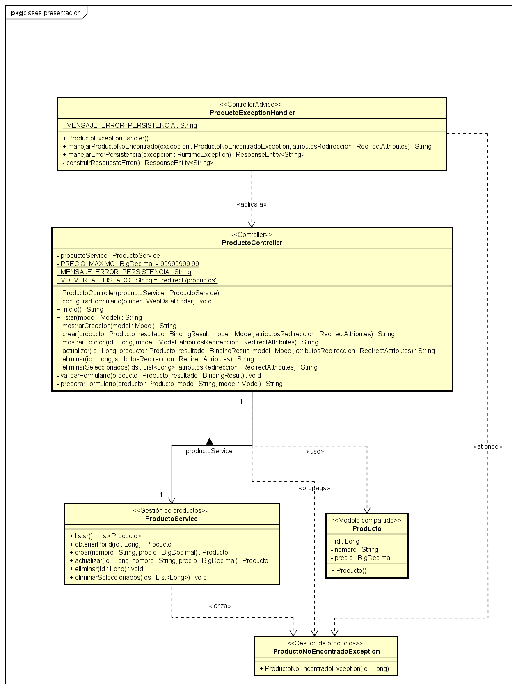

## 6. Descripción de clases e interfaces Java

### 6.1. Descripción individual según el formato solicitado

Las siguientes fichas describen las cuatro clases e interfaces asignadas a Ramón, según el código implementado en `develop`. Los identificadores **IG-XX** corresponden a las interfaces de salida de Gestión de productos y los **IP-XX** a las de Persistencia de productos, ambos del apartado 4 de `said.md`.

#### ProductoService

| Dato | Definición |
| --- | --- |
| Tipo | Clase. |
| Paquete | `com.equipo.gestorproductos.service` |
| Componente | Gestión de productos. |

Concentra la lógica de negocio del catálogo: valida y normaliza el nombre y el precio, comprueba que los productos existan, coordina las operaciones con `ProductoRepository` y define los límites transaccionales. Interpreta los resultados del repositorio (un `Optional` vacío o menos registros de los solicitados). No conoce rutas, plantillas ni mensajes flash. Se anota con `@Service` y `@Transactional` a nivel de clase; `listar` y `obtenerPorId` usan `@Transactional(readOnly = true)`.

**Dependencias y relaciones**

| Clase o interfaz relacionada | Relación y propósito |
| --- | --- |
| `ProductoRepository` | Asociación dirigida mediante el atributo `productoRepository`, inyectado por constructor. Requiere `findAll(Sort)` (Persistencia de productos · IP-01), `findById` (IP-02), `findAllById` (IP-03), `save` (IP-04), `delete` (IP-05) y `deleteAll` (IP-06). |
| `Producto` | Dependencia de uso: es la entidad que se crea, modifica, consulta y devuelve. |
| `ProductoNoEncontradoException` | Dependencia «lanza»: señala un producto inexistente. |
| `Sort` (Spring Data) | Dependencia de uso: define el orden ascendente por ID de `listar`. |
| `ProductoController` | Es usada por el controlador de Fabio, que consume `listar` (IG-01), `obtenerPorId` (IG-02), `crear` (IG-03), `actualizar` (IG-04), `eliminar` (IG-05) y `eliminarSeleccionados` (IG-06). |

**Atributos**

| Nombre | Tipo | Visibilidad | Valor inicial o asignación | Descripción |
| --- | --- | --- | --- | --- |
| `productoRepository` | `ProductoRepository` | `private final` | Inyectado mediante el constructor. | Acceso a los datos de los productos. |
| `NOMBRE_MAX_LONGITUD` | `int` | `private static final` | `100` | Longitud máxima del nombre, tras recortarlo. |
| `PRECIO_MAXIMO` | `BigDecimal` | `private static final` | `new BigDecimal("99999999.99")` | Precio máximo permitido; el mínimo es cero. |
| `PRECIO_ESCALA_MAXIMA` | `int` | `private static final` | `2` | Máximo de decimales del precio, según la escala del valor recibido. |
| `MSG_ID_INVALIDO` | `String` | `private static final` | `"El ID del producto debe ser un número positivo"` | ID nulo o no positivo. |
| `MSG_NOMBRE_OBLIGATORIO` | `String` | `private static final` | `"El nombre es obligatorio"` | Nombre nulo, vacío o solo espacios. |
| `MSG_NOMBRE_LARGO` | `String` | `private static final` | `"El nombre no puede exceder 100 caracteres"` | Nombre de más de 100 caracteres tras recortarlo. |
| `MSG_PRECIO_OBLIGATORIO` | `String` | `private static final` | `"El precio es obligatorio"` | Precio nulo. |
| `MSG_PRECIO_RANGO` | `String` | `private static final` | `"El precio debe estar entre 0 y 99999999.99"` | Precio negativo o mayor que el máximo. |
| `MSG_PRECIO_DECIMALES` | `String` | `private static final` | `"El precio admite como máximo dos decimales"` | Precio con escala mayor que dos. |
| `MSG_SELECCION_VACIA` | `String` | `private static final` | `"Selecciona al menos un producto"` | Selección nula o vacía. |
| `MSG_SELECCION_INVALIDA` | `String` | `private static final` | `"La selección contiene IDs no válidos"` | Elemento nulo o no positivo en la selección. |

**Operaciones**

| Firma completa | Descripción | Componente e interfaz de salida |
| --- | --- | --- |
| `public ProductoService(ProductoRepository productoRepository)` | Inicializa el servicio con el repositorio que Spring administra. | No aplica |
| `public List<Producto> listar()` | Consulta con `findAll(Sort.by(Sort.Direction.ASC, "id"))` (IP-01). Devuelve los productos por ID ascendente; lista vacía si no hay ninguno, nunca nula. Transacción de solo lectura. | Gestión de productos · IG-01 |
| `public Producto obtenerPorId(Long id)` | Valida el ID, lo busca con `findById` (IP-02) y devuelve el producto. Lanza `IllegalArgumentException` si el ID es inválido y `ProductoNoEncontradoException` si no existe. Transacción de solo lectura. | Gestión de productos · IG-02 |
| `public Producto crear(String nombre, BigDecimal precio)` | Valida y recorta el nombre, valida el precio, crea un `Producto` con ID nulo y lo guarda con `save` (IP-04). Devuelve el producto con el ID generado. Lanza `IllegalArgumentException` si el nombre o el precio son inválidos. | Gestión de productos · IG-03 |
| `public Producto actualizar(Long id, String nombre, BigDecimal precio)` | Valida el ID, comprueba que el producto exista, valida nombre y precio, modifica la instancia ya cargada y la guarda con `save` (IP-04). Conserva el ID y nunca crea un producto sustituto. Lanza `IllegalArgumentException` si el ID, el nombre o el precio son inválidos y `ProductoNoEncontradoException` si el producto no existe. | Gestión de productos · IG-04 |
| `public void eliminar(Long id)` | Valida el ID, comprueba que el producto exista con `findById` (IP-02) y lo elimina con `delete` (IP-05). Lanza `IllegalArgumentException` si el ID es inválido y `ProductoNoEncontradoException` si no existe. | Gestión de productos · IG-05 |
| `public void eliminarSeleccionados(List<Long> ids)` | Valida la selección, carga los productos con `findAllById` (IP-03) y los elimina con `deleteAll` (IP-06), todo en una sola transacción. Lanza `IllegalArgumentException` si la selección es vacía o inválida y `ProductoNoEncontradoException` si falta algún ID. Ver «Eliminación múltiple en una sola transacción». | Gestión de productos · IG-06 |
| `private void validarId(Long id)` | Rechaza un ID nulo o menor o igual que cero con `MSG_ID_INVALIDO`. | No aplica |
| `private Producto buscarExistente(Long id)` | Busca con `findById` (IP-02) y lanza `ProductoNoEncontradoException(id)` si el resultado está vacío. | No aplica |
| `private String validarNombre(String nombre)` | Rechaza un nombre nulo o vacío tras `strip()` y uno de más de 100 caracteres, contados en puntos de código como `VARCHAR(100)`. Devuelve el nombre recortado. | No aplica |
| `private BigDecimal validarPrecio(BigDecimal precio)` | Rechaza un precio nulo, con `precio.scale()` mayor que dos o fuera de 0–99999999.99. Devuelve el valor con `setScale(2, RoundingMode.UNNECESSARY)`, que no redondea. | No aplica |
| `private Set<Long> validarSeleccion(List<Long> ids)` | Rechaza una lista nula o vacía y los elementos nulos o no positivos. Devuelve un `LinkedHashSet` sin repetidos, en el orden recibido. | No aplica |

**Reglas comunes**

- **IDs:** deben ser no nulos y positivos. Un ID inválido lanza `IllegalArgumentException` con `MSG_ID_INVALIDO`.
- **Nombre:** se recorta con `strip()` y debe tener de 1 a 100 caracteres. Se guarda ya recortado.
- **Precio:** se verifica `precio.scale()` antes de normalizar. `10.500` y `10.505` se rechazan; `10.5` y `10.50` se aceptan y se guardan como `10.50`. Después se comprueba el rango de 0 a 99999999.99. Nunca se redondea una entrada inválida.
- **Argumentos inválidos:** `IllegalArgumentException` con el mensaje de la constante `MSG_*` correspondiente. Las validaciones se aplican antes de guardar o eliminar.
- **Producto inexistente:** `ProductoNoEncontradoException(id)`, con el mensaje «No se encontró el producto con ID {id}».
- **Orden de comprobación en `actualizar`:** ID, existencia y, por último, nombre y precio. Si los datos son inválidos, no se modifica ni se guarda nada.
- **Transacciones:** toda la clase es transaccional. Las excepciones previstas no son verificadas, por lo que revierten la transacción en la que se lanzan.
- **Errores técnicos de persistencia:** el servicio no los convierte ni los oculta; se propagan a la presentación, que los atiende con un mensaje general sin detalles internos.

**Eliminación múltiple en una sola transacción**

1. Se valida la selección: lista nula o vacía, `MSG_SELECCION_VACIA` («Selecciona al menos un producto»); elemento nulo o no positivo, `MSG_SELECCION_INVALIDA`. Los IDs repetidos se procesan una sola vez.
2. Se cargan los productos con `findAllById` (IP-03).
3. Si se obtienen menos productos que IDs distintos, se lanza `ProductoNoEncontradoException` con el primer ID faltante en el orden recibido. No se ha borrado nada.
4. Se eliminan los productos cargados con `deleteAll` (IP-06) dentro de la misma transacción.

Como la carga y el borrado ocurren en una sola transacción, un fallo en cualquier punto revierte toda la operación y no queda un borrado parcial. `ProductoServiceIntegracionTest` comprueba en MySQL que, si el borrado falla después de ejecutar al menos una eliminación, esas eliminaciones se revierten y los demás productos permanecen en la tabla.

**Llamadas al repositorio, en orden**

| Operación del servicio | Llamadas a `ProductoRepository` | Alternativas |
| --- | --- | --- |
| `listar()` | `findAll(Sort)` | Sin productos: lista vacía. |
| `obtenerPorId(id)` | `findById(id)` | ID inválido: `IllegalArgumentException`, sin consultar. `Optional` vacío: `ProductoNoEncontradoException`. |
| `crear(nombre, precio)` | `save(producto)` | Datos inválidos: `IllegalArgumentException`, sin guardar. |
| `actualizar(id, nombre, precio)` | `findById(id)` y luego `save(producto)` | ID inválido: `IllegalArgumentException`, sin consultar. Inexistente: `ProductoNoEncontradoException`, sin guardar. Datos inválidos: `IllegalArgumentException`, sin guardar. |
| `eliminar(id)` | `findById(id)` y luego `delete(producto)` | ID inválido: `IllegalArgumentException`. Inexistente: `ProductoNoEncontradoException`, sin eliminar. |
| `eliminarSeleccionados(ids)` | `findAllById(ids sin repetidos)` y luego `deleteAll(productos)` | Selección vacía o inválida: `IllegalArgumentException`, sin consultar. Falta algún ID: `ProductoNoEncontradoException`, sin eliminar. Fallo posterior: reversión completa. |

#### ProductoRepository

| Dato | Definición |
| --- | --- |
| Tipo | Interfaz. |
| Paquete | `com.equipo.gestorproductos.repository` |
| Componente | Persistencia de productos. |

Da acceso a la tabla `productos` mediante Spring Data JPA; Spring genera su implementación en tiempo de ejecución. Extiende `JpaRepository<Producto, Long>` y no declara métodos propios. Solo accede a los datos: la validación y la interpretación de los resultados ausentes corresponden a `ProductoService`.

**Dependencias y relaciones**

| Clase o interfaz relacionada | Relación y propósito |
| --- | --- |
| `JpaRepository<Producto, Long>` | Generalización: de ella hereda las operaciones de consulta, guardado y eliminación. |
| `Producto` | Dependencia por argumento de tipo: es la entidad que gestiona. |
| `Long` | Dependencia por argumento de tipo: es el tipo de la clave primaria. |
| `ProductoService` | Es usada por el servicio, que consume sus operaciones heredadas (IP-01 a IP-06). |

**Atributos**

No aplica: la interfaz no declara atributos.

**Operaciones**

Origen: todas las operaciones son heredadas de `JpaRepository`; la interfaz no declara ninguna. Se listan las que usa el servicio, con `T = Producto` e `ID = Long`.

| Firma completa | Descripción | Componente e interfaz de salida |
| --- | --- | --- |
| `List<Producto> findAll(Sort sort)` | Recupera todos los productos con el orden indicado; lista vacía si no hay registros. | Persistencia de productos · IP-01 |
| `Optional<Producto> findById(Long id)` | Busca un producto por su clave primaria. Devuelve un `Optional` vacío cuando no existe; el servicio lo interpreta. | Persistencia de productos · IP-02 |
| `List<Producto> findAllById(Iterable<Long> ids)` | Recupera los productos existentes entre los IDs recibidos. Puede devolver menos registros que IDs solicitados; el servicio compara el resultado. | Persistencia de productos · IP-03 |
| `<S extends Producto> S save(S entity)` | Inserta el producto si su ID es nulo (MySQL genera el ID) o actualiza el existente. Devuelve el producto guardado. | Persistencia de productos · IP-04 |
| `void delete(Producto entity)` | Elimina el registro del producto recibido. | Persistencia de productos · IP-05 |
| `void deleteAll(Iterable<? extends Producto> entities)` | Elimina los registros de los productos recibidos dentro de la transacción en curso. | Persistencia de productos · IP-06 |

Las operaciones son públicas por ser miembros de una interfaz. No se requieren métodos personalizados inicialmente. Los fallos técnicos de acceso a datos llegan al servicio como excepciones de Spring y no se convierten en este nivel.

#### Producto

| Dato | Definición |
| --- | --- |
| Tipo | Clase (entidad JPA). |
| Paquete | `com.equipo.gestorproductos.model` |
| Componente | Modelo compartido por Presentación web, Gestión de productos y Persistencia de productos. |

Representa un producto del catálogo y establece la correspondencia con una fila de la tabla `productos` de la base `gestor_productos`. Es un objeto de datos: no valida ni recorta valores, tarea que corresponde al servicio. Se anota con `@Entity` y `@Table(name = "productos")` (Jakarta Persistence). Su estructura coincide con la sección 7 de `said.md` y con `sql/01-crear-tabla-productos.sql`. Los precios están en MXN y los nombres pueden repetirse.

**Dependencias y relaciones**

| Clase o interfaz relacionada | Relación y propósito |
| --- | --- |
| Tabla `productos` (MySQL) | Correspondencia objeto-relacional mediante JPA: cada instancia equivale a una fila. |
| `ProductoRepository` | Es la entidad gestionada por el repositorio. |
| `ProductoService` | Es creada, modificada y devuelta por el servicio. |
| `ProductoController` | Es el producto que el controlador muestra y captura; solo `nombre` y `precio` son enlazables. |

**Atributos**

| Nombre | Tipo | Visibilidad | Valor inicial o asignación | Descripción |
| --- | --- | --- | --- | --- |
| `id` | `Long` | `private` | `null` hasta guardar; lo genera MySQL con `@Id` y `@GeneratedValue(strategy = GenerationType.IDENTITY)`. | Clave primaria `BIGINT` autoincremental; no editable. |
| `nombre` | `String` | `private` | `null`; lo asigna el servicio ya recortado. Mapeado con `@Column(name = "nombre", nullable = false, length = 100)`. | `VARCHAR(100)`, obligatorio, de 1 a 100 caracteres. |
| `precio` | `BigDecimal` | `private` | `null`; lo asigna el servicio con escala 2. Mapeado con `@Column(name = "precio", nullable = false, precision = 10, scale = 2)`. | `DECIMAL(10,2)`, obligatorio, de 0 a 99999999.99, en MXN. |

**Operaciones**

| Firma completa | Descripción | Componente e interfaz de salida |
| --- | --- | --- |
| `public Producto()` | Crea un producto con todos sus atributos en `null`; JPA lo exige. Es el único constructor. | No aplica |
| `public Long getId()` | Devuelve el ID; `null` si aún no se guardó. | No aplica |
| `public void setId(Long id)` | Asigna el ID. El usuario no puede capturarlo ni modificarlo; el servicio nunca lo asigna a partir de datos del formulario. | No aplica |
| `public String getNombre()` | Devuelve el nombre. | No aplica |
| `public void setNombre(String nombre)` | Asigna el nombre sin validarlo ni recortarlo. | No aplica |
| `public BigDecimal getPrecio()` | Devuelve el precio. | No aplica |
| `public void setPrecio(BigDecimal precio)` | Asigna el precio sin validarlo ni redondearlo. | No aplica |

`equals`, `hashCode` y `toString` no están definidos; se usan los de `Object`.

#### ProductoNoEncontradoException

| Dato | Definición |
| --- | --- |
| Tipo | Excepción (no verificada). |
| Paquete | `com.equipo.gestorproductos.exception` |
| Componente | Gestión de productos. |

Indica que se intentó consultar, modificar o eliminar un producto que no existe. La lanza `ProductoService`; el controlador de Fabio la deja salir y `ProductoExceptionHandler` la convierte en una redirección al listado con su mensaje. Al ser `RuntimeException`, revierte la transacción en la que se lanza.

**Dependencias y relaciones**

| Clase o interfaz relacionada | Relación y propósito |
| --- | --- |
| `RuntimeException` | Generalización: excepción no verificada, que no obliga a declarar `throws`. |
| `ProductoService` | Es lanzada por el servicio en `obtenerPorId`, `actualizar`, `eliminar` y `eliminarSeleccionados`. |
| `ProductoController` | Dependencia por propagación: la deja salir hacia el manejador. |
| `ProductoExceptionHandler` | Es atendida por el manejador, que toma de ella el mensaje. |

**Atributos**

| Nombre | Tipo | Visibilidad | Valor inicial o asignación | Descripción |
| --- | --- | --- | --- | --- |
| `serialVersionUID` | `long` | `private static final` | `1L` | Versión de serialización de la excepción. |

**Operaciones**

| Firma completa | Descripción | Componente e interfaz de salida |
| --- | --- | --- |
| `public ProductoNoEncontradoException(Long id)` | Crea la excepción con el mensaje «No se encontró el producto con ID {id}». No guarda el ID en un atributo: el mensaje ya lo incorpora. | No aplica |
| `public String getMessage()` | Devuelve el mensaje de la excepción. Heredada de `Throwable`; no se sobrescribe. | No aplica |

### 6.2. Diagrama general de clases

El siguiente diagrama es el general del proyecto. Reúne las clases de presentación de Fabio y las de Gestión y Persistencia de productos de Ramón, con sus atributos, operaciones y relaciones. En `ProductoRepository` se distinguen las operaciones heredadas de `JpaRepository`. El archivo editable de Astah es `../../diagramas/clases-presentacion.asta`.

Relaciones de las clases de esta aportación. Las de `ProductoController` y `ProductoExceptionHandler` se describen en `fabio.md`.

| Origen | Destino | Relación |
| --- | --- | --- |
| `ProductoService` | `ProductoRepository` | Asociación dirigida (`productoRepository`, 1 a 1). |
| `ProductoService` | `Producto` | Dependencia «use». |
| `ProductoService` | `ProductoNoEncontradoException` | Dependencia «lanza». |
| `ProductoRepository` | `JpaRepository<Producto, Long>` | Generalización (extiende). |
| `ProductoRepository` | `Producto` | Dependencia «gestiona». |
| `ProductoNoEncontradoException` | `RuntimeException` | Generalización (extiende). |
