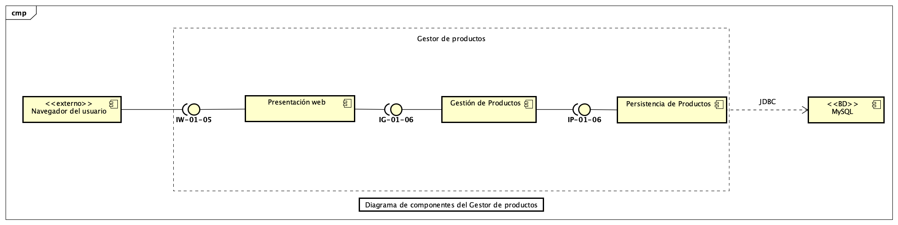

## 3. Arquitectura

### 3.1. Organización por capas y MVC

El sistema será una aplicación web organizada en tres capas: presentación, lógica de negocio y acceso a datos. Se ejecutará como una sola aplicación Spring Boot, conectada a MySQL.

| Capa | Elementos principales | Responsabilidad |
| --- | --- | --- |
| Presentación | ProductoController y plantillas Thymeleaf con HTML/CSS/JS | Recibir las acciones del usuario y mostrar los resultados. |
| Lógica de negocio | ProductoService | Aplicar las reglas y coordinar las operaciones y transacciones. |
| Acceso a datos | ProductoRepository, Spring Data JPA y MySQL Connector/J | Consultar, guardar y eliminar los productos almacenados en MySQL. |

La clase Producto representará los datos del catálogo y será utilizada por las distintas capas.

El manejo de errores se apoyará en ProductoNoEncontradoException, lanzada por el servicio cuando un producto no exista, y ProductoExceptionHandler, que atenderá esa excepción desde presentación para comunicar el problema al usuario.

La interacción web seguirá el patrón Modelo–Vista–Controlador (MVC). El controlador recibirá las solicitudes del navegador y solicitará las operaciones al servicio. Las vistas Thymeleaf generarán las páginas HTML con los datos proporcionados por el controlador. El modelo comprenderá los datos y las reglas de la aplicación, organizados mediante la entidad, el servicio y el repositorio.

### 3.2. Justificación de las decisiones arquitectónicas

La arquitectura por capas permitirá separar la presentación, la lógica de negocio y el acceso a datos. Cada parte tendrá una responsabilidad definida, lo que facilitará localizar errores, revisar cambios y distribuir el trabajo del equipo.

La lógica de negocio se concentrará en ProductoService para que las operaciones apliquen las mismas reglas independientemente de la pantalla que las solicite. El acceso a MySQL quedará concentrado en ProductoRepository, evitando que los controladores tengan que realizar operaciones de persistencia directamente.

El patrón MVC organizará la interacción web mediante la separación entre los datos de la aplicación, las vistas y los controladores. Esto permitirá modificar la presentación de las pantallas manteniendo las operaciones del catálogo en sus clases correspondientes.

Spring Boot facilitará la configuración y ejecución del proyecto mediante un servidor web integrado. Spring MVC y Thymeleaf permitirán atender las solicitudes y generar páginas HTML dentro de la misma aplicación, una solución adecuada para un catálogo basado en listados y formularios.

Spring Data JPA facilitará las operaciones habituales de persistencia y la correspondencia entre los objetos Java y los registros de MySQL. Esta separación permitirá trabajar con los productos desde el servicio sin incluir allí los detalles de acceso a la base de datos.

El sistema se ejecutará como una sola aplicación conectada a una base de datos. Esta organización es proporcional al alcance del proyecto y simplificará su configuración, integración y ejecución local.

### 3.3. Relaciones y comunicación entre las partes

Las solicitudes que requieran consultar o modificar productos seguirán este recorrido:

Navegador → ProductoController → ProductoService → ProductoRepository → MySQL

ProductoController recibirá la solicitud y los datos enviados por el navegador. Después solicitará la operación correspondiente a ProductoService, que aplicará las reglas de negocio y utilizará ProductoRepository para acceder a los registros.

Los resultados regresarán al controlador a través del servicio. Para mostrar una pantalla, el controlador proporcionará los datos al modelo de la vista y Thymeleaf generará la página HTML que recibirá el navegador. Cuando corresponda actualizar el listado tras una operación, el controlador realizará una redirección.

Las excepciones previstas se comunicarán desde la capa que las detecte y se atenderán en presentación para generar una respuesta comprensible para el usuario.

## 4. Descripción de componentes

El sistema se dividirá en tres componentes lógicos: Presentación web, Gestión de productos y Persistencia de productos. Los tres formarán parte de una sola aplicación.

En esta descripción, las interfaces de salida identificarán los servicios ofrecidos por el componente y las interfaces de entrada los servicios que requiere de otros componentes.

Cada interfaz ofrecida tendrá un identificador único: IW para Presentación web, IG para Gestión de productos e IP para Persistencia de productos. Estos identificadores se utilizarán en la descripción de clases para relacionar las funciones con los servicios que implementan. Cuando otro componente requiera una interfaz, conservará el identificador de su proveedor.

### 4.1. Presentación web

**Nombre:** Presentación web.

**Descripción:** permitirá al usuario consultar y administrar los productos mediante el listado y los formularios. Recibirá las solicitudes del navegador, solicitará las operaciones de negocio y preparará las páginas y los mensajes de respuesta.

**Dependencias con otros componentes:** utilizará los servicios de Gestión de productos para consultar, crear, actualizar y eliminar registros.

**Interfaces de salida — servicios ofrecidos:**

| Identificador | Nombre | Descripción |
| --- | --- | --- |
| IW-01 | Consulta del catálogo | Mostrará el listado de productos mediante `GET /productos`. |
| IW-02 | Registro de productos | Presentará el formulario de creación mediante `GET /productos/nuevo` y recibirá los datos del nuevo producto mediante `POST /productos`. |
| IW-03 | Edición de productos | Presentará los datos actuales mediante `GET /productos/{id}/editar` y recibirá las modificaciones mediante `POST /productos/{id}`. |
| IW-04 | Eliminación individual | Recibirá y atenderá la solicitud de eliminar un producto mediante `POST /productos/{id}/eliminar`. |
| IW-05 | Eliminación seleccionada | Recibirá y atenderá la solicitud de eliminar los productos seleccionados mediante `POST /productos/eliminar-seleccionados`. |

Estas interfaces se ofrecerán mediante los métodos de `ProductoController`: `listar` para IW-01; `mostrarCreacion` y `crear` para IW-02; `mostrarEdicion` y `actualizar` para IW-03; `eliminar` para IW-04; y `eliminarSeleccionados` para IW-05.

Estas interfaces serán utilizadas por el usuario a través del navegador, que enviará las solicitudes HTTP y recibirá las páginas y respuestas de la aplicación.

La ruta inicial `GET /` redirigirá a `/productos`. La selección de todos los registros se realizará en la pantalla y utilizará IW-05 para solicitar su eliminación.

**Interfaces de entrada — servicios requeridos:**

IG-01, IG-02, IG-03, IG-04, IG-05 e IG-06, ofrecidas por Gestión de productos mediante `ProductoService`. Sus nombres y descripciones se encuentran en el apartado 4.2.

**Artefactos:**

- `ProductoController.java` y `ProductoExceptionHandler.java`.
- Modelo compartido `Producto.java`.
- Plantillas `listado.html` y `formulario.html`.
- Recursos `estilos.css` y `productos.js`.
- Spring MVC y Thymeleaf.

### 4.2. Gestión de productos

**Nombre:** Gestión de productos.

**Descripción:** aplicará las reglas del catálogo, comprobará la existencia de los productos y coordinará las operaciones y transacciones. Proporcionará sus resultados a Presentación web.

**Dependencias con otros componentes:** utilizará Persistencia de productos para consultar y modificar los registros almacenados.

**Interfaces de salida — servicios ofrecidos:**

| Identificador | Nombre | Descripción |
| --- | --- | --- |
| IG-01 | Listar productos | Obtendrá el catálogo ordenado por identificador ascendente. Si no hay registros, devolverá una lista vacía. |
| IG-02 | Obtener producto por ID | Obtendrá un producto mediante su identificador o comunicará que no existe. |
| IG-03 | Crear producto | Registrará un producto aplicando las reglas del catálogo y devolverá el producto guardado con su identificador generado. |
| IG-04 | Actualizar producto | Modificará un producto existente aplicando las reglas del catálogo y conservando su identificador. |
| IG-05 | Eliminar producto | Comprobará la existencia del producto y coordinará su eliminación. |
| IG-06 | Eliminar productos seleccionados | Coordinará la eliminación del conjunto solicitado dentro de una sola transacción, evitando un borrado parcial si ocurre un fallo. |

Estas interfaces se ofrecerán mediante los métodos `listar`, `obtenerPorId`, `crear`, `actualizar`, `eliminar` y `eliminarSeleccionados` de `ProductoService`, respectivamente.

Las operaciones aplicarán las reglas definidas en la sección 1. Un producto inexistente se comunicará mediante `ProductoNoEncontradoException`; los argumentos inválidos, mediante `IllegalArgumentException`.

**Interfaces de entrada — servicios requeridos:**

IP-01, IP-02, IP-03, IP-04, IP-05 e IP-06, ofrecidas por Persistencia de productos mediante `ProductoRepository`. Sus nombres y descripciones se encuentran en el apartado 4.3.

**Artefactos:**

- `ProductoService.java`.
- `ProductoNoEncontradoException.java`.
- Modelo compartido `Producto.java`.
- Soporte de transacciones de Spring.

### 4.3. Persistencia de productos

**Nombre:** Persistencia de productos.

**Descripción:** proporcionará acceso a los registros de la tabla `productos`. Realizará las consultas, guardados y eliminaciones solicitados por Gestión de productos.

**Dependencias con otros componentes:** utilizará los servicios de almacenamiento de MySQL para consultar y modificar la tabla `productos`. La entidad `Producto` establecerá la correspondencia entre los objetos Java y los registros.

**Interfaces de salida — servicios ofrecidos:**

| Identificador | Nombre | Descripción |
| --- | --- | --- |
| IP-01 | Consultar productos ordenados | Recuperará los registros con el orden solicitado mediante `findAll(Sort)`. |
| IP-02 | Buscar producto por ID | Buscará un registro mediante `findById(Long)` y devolverá un resultado vacío cuando no exista. |
| IP-03 | Consultar productos por IDs | Recuperará los registros existentes entre los identificadores recibidos mediante `findAllById(Iterable<Long>)`. |
| IP-04 | Guardar producto | Persistirá un producto nuevo o modificado mediante `save(Producto)` y devolverá el producto guardado. |
| IP-05 | Eliminar producto persistido | Borrará el registro recibido mediante `delete(Producto)`. |
| IP-06 | Eliminar conjunto de productos | Borrará los registros recibidos mediante `deleteAll(Iterable<Producto>)`. |

Estas operaciones serán heredadas por `ProductoRepository`, que extenderá `JpaRepository<Producto, Long>`. Gestión de productos interpretará sus resultados y coordinará las transacciones necesarias.

**Interfaces de entrada — servicios requeridos:**

| Nombre | Proveedor | Descripción |
| --- | --- | --- |
| Acceso a MySQL mediante JDBC | MySQL | Permitirá conectarse a la base `gestor_productos` y ejecutar consultas y modificaciones sobre la tabla `productos`, utilizando MySQL Connector/J. |

Esta interfaz corresponde a un servicio externo de almacenamiento, por lo que no utiliza los identificadores IW, IG o IP de los componentes propios.

**Artefactos:**

- `ProductoRepository.java`.
- Modelo compartido `Producto.java`.
- Spring Data JPA, Hibernate y MySQL Connector/J.
- `application.properties` y configuración local de conexión.
- Scripts SQL de creación de la base de datos y la tabla.

### 4.4. Diagrama general de componentes

El marco delimita los tres componentes del Gestor de Productos. Fuera de él, el navegador se comunica con Presentación web y MySQL proporciona el almacenamiento al que accede Persistencia de productos mediante JDBC. Las etiquetas IW, IG e IP agrupan las interfaces descritas en los apartados anteriores.



## 5. Estructura del proyecto

### 5.1. Árbol de paquetes y archivos previstos

El código Java se organizará bajo el paquete raíz `com.equipo.gestorproductos`. Las plantillas, los recursos estáticos y la configuración se ubicarán en `src/main/resources`.

La estructura prevista será la siguiente.

```text
src/
└── main/
    ├── java/com/equipo/gestorproductos/
    │   ├── GestorProductosApplication.java
    │   ├── controller/
    │   │   └── ProductoController.java
    │   ├── service/
    │   │   └── ProductoService.java
    │   ├── repository/
    │   │   └── ProductoRepository.java
    │   ├── model/
    │   │   └── Producto.java
    │   └── exception/
    │       ├── ProductoNoEncontradoException.java
    │       └── ProductoExceptionHandler.java
    └── resources/
        ├── application.properties
        ├── templates/productos/
        │   ├── listado.html
        │   └── formulario.html
        └── static/
            ├── css/
            │   └── estilos.css
            └── js/
                └── productos.js
```

El proyecto base ya contiene `GestorProductosApplication.java` y `application.properties`. Los demás archivos del árbol se incorporarán durante la implementación.

La plantilla `formulario.html` se utilizará para crear y editar productos, ajustando el título, los datos y la acción del formulario según la operación.

### 5.2. Correspondencia entre archivos y componentes

| Componente | Archivos principales |
| --- | --- |
| Presentación web | `controller/ProductoController.java`, `exception/ProductoExceptionHandler.java`, las plantillas `listado.html` y `formulario.html`, y los recursos `estilos.css` y `productos.js`. |
| Gestión de productos | `service/ProductoService.java` y `exception/ProductoNoEncontradoException.java`. |
| Persistencia de productos | `repository/ProductoRepository.java`, apoyado en el mapeo de `model/Producto.java`. |

`Producto.java` será el modelo compartido por las distintas capas. El paquete `exception` reunirá la excepción de negocio y su manejador web, cada uno con la responsabilidad indicada en su componente.

`GestorProductosApplication.java` y `application.properties` proporcionarán el arranque y la configuración general de la aplicación.
